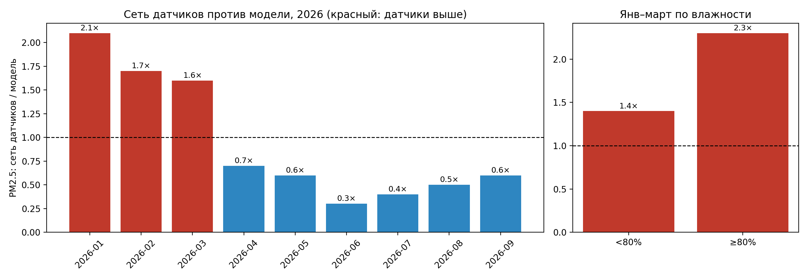

# Breathe Bishkek

Bishkek is one of the most polluted cities in the world during
the winter heating season. Public sensors show current values,
but there is no open, structured record of how air quality moves
together with weather over time.

This repository collects that record.

## What it does

Every hour, a GitHub Action pulls current air quality and weather
for Bishkek and appends one row to `data/bishkek_air.csv`.

| Column | Meaning |
|---|---|
| `time` | Timestamp of the reading (Asia/Bishkek) |
| `collected_at` | When the script ran |
| `pm2_5`, `pm10`, `co` | Pollutant concentrations, µg/m³ |
| `temp`, `humidity`, `wind`, `pressure` | Weather conditions |

## Data source

[Open-Meteo](https://open-meteo.com) air quality and forecast APIs.

## Status

Collecting data since August 2026. Analysis to follow once enough
of the heating season is covered.

---

Built by Ibrahim, Bishkek.

## Preliminary findings (Jan–Oct 2026)

Hourly PM2.5 from 3–5 community SDS011 sensors (sensor.community) in central and eastern Bishkek
was compared with the Open-Meteo/CAMS model for the city centre on matched hours
(network = median of at least 3 sensors).

- **Heating season (Jan–Mar):** the sensor network median is 1.6–2.1x the model
  (40.9 vs 19.5 µg/m³ in January). For hours with model RH < 80% (to limit SDS011 humidity bias)
  the ratio is 1.4x; for RH >= 80% it is 2.3x.
- **Apr–Sep:** the network median is 3–5 µg/m³ vs 8–10 for the model (ratio 0.3–0.7x), a gap of the
  same order as the sensors' stated measurement error.
- Individual sensors disagree strongly (January monthly medians range from 22 to 87 µg/m³).
  One sensor shows uncorroborated spikes up to ~500 µg/m³; the >=3-sensor median rule suppresses them.

**Limitations:** sensors are not calibrated against a reference monitor; the network is concentrated
on the eastern side of the city; a model grid cell is not a point measurement; humidity bias
is not removed, only stratified.

## Pre-registered check (written 28 Oct 2026, before any November data)

If the Jan–Mar 2026 finding holds, the sensor-network / model ratio of monthly median PM2.5
for November 2026 will be at least 1.4, using the same method (median of at least 3 sensors,
matched hours, Open-Meteo/CAMS at 42.8746, 74.5698).
If the ratio is below 1.4, I will report that the winter gap did not replicate.
